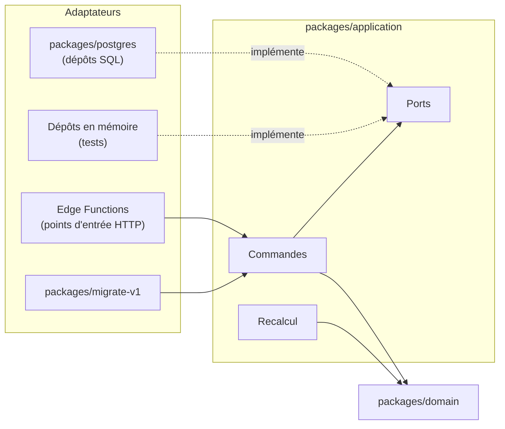

# 0023 — Les écritures en trois couches

- **Statut** : Accepté
- **Date** : 2026-11-19
- **Amende** : [0005](0005-ecritures-par-commandes.md) (où vit la logique d'une commande), [0001](0001-monorepo-et-domaine-pur.md) (les paquets)

## Contexte

L'[ADR 0001](0001-monorepo-et-domaine-pur.md) isole un domaine pur, et
l'[ADR 0005](0005-ecritures-par-commandes.md) fait passer chaque écriture par
une commande. Mais l'ADR 0005 met toute la commande dans son Edge Function :
autorisation, validation, transaction, contrôle de version, écriture,
recalcul. La logique d'une commande serait collée à Deno, à HTTP et au SQL, et
ne se testerait qu'avec une base.

La tranche 1 montre déjà le problème. Le recalcul des projections
(`recomputeProjections`) et l'écriture des faits (`loadPlan`) vivent dans
l'outil de migration `packages/migrate-v1`, et parlent SQL directement. Or
chaque commande de la tranche 2 a besoin du même recalcul.

Côté lecture, la règle est déjà la bonne : les pages dépendent d'une interface
(`DataSource`), et deux implémentations la remplissent, Supabase et la mémoire
des tests ([ADR 0019](0019-lire-la-base-depuis-le-site.md)).

La tranche 2 compte une quinzaine de commandes, qui copieront toutes la
première. C'est le moment de fixer leur forme.

## Décision

**Trois couches.** Chacune n'importe que les couches plus au centre. Une règle
de lint (`no-restricted-imports`) l'impose paquet par paquet.

1. **Domaine** (`packages/domain`) : inchangé. Règles pures, sans I/O.
2. **Application** (`packages/application`, nouveau, ne dépend que du domaine) :
   - **une commande est une fonction** (`importEdition`, `closeSeason`…) qui
     reçoit son entrée déjà validée, l'acteur, et ses ports ;
   - **les ports** sont des interfaces nommées en langage métier : un dépôt
     par agrégat (`EditionRepository`…), qui rend aussi la version de
     l'agrégat ; `ProjectionStore` ; `CommandLog` (ADR 0009) ; `Clock` ;
   - **l'acteur** dit qui agit et dans quelle organisation. La commande vérifie
     elle-même qu'il en a le droit (admin de l'organisation, ou propriétaire de
     sa carte) ;
   - le **contrôle de version** renvoie une erreur métier de conflit ;
   - le **recalcul des projections** est une fonction de cette couche : il
     quitte `migrate-v1`.
3. **Adaptateurs**, à la périphérie :
   - `packages/postgres` implémente les ports avec postgres.js, déjà utilisé.
     Il ouvre la transaction et prend le verrou de l'organisation (ADR 0009) ;
   - des **dépôts en mémoire** (`packages/application/src/testing`)
     implémentent les mêmes ports pour les tests des commandes ;
   - une **Edge Function** reste mince : lire le JWT et en faire un acteur,
     valider l'entrée (`packages/contracts`), ouvrir une transaction, appeler
     la commande, traduire le résultat en HTTP (le conflit devient `409`) ;
   - `packages/migrate-v1` devient un adaptateur comme un autre : il écrit les
     faits par les dépôts, puis appelle le recalcul.

**La lecture reste à part.** Les vues SQL sont le modèle de lecture : elles
assemblent et trient, sans règle de note. Les pages les lisent par `DataSource`
(ADR 0019). Écrire et lire par deux chemins différents est voulu.

**Les contrats** (`packages/contracts`, prévus par l'ADR 0001) naissent avec la
première commande qui a une entrée à valider. Zod est une dépendance : elle
sera redemandée à ce moment-là.

## Options écartées

- **Garder l'ADR 0005 tel quel**, toute la commande dans l'Edge Function :
  moins de fichiers, mais une commande ne se teste qu'avec une base, et chaque
  Edge Function réécrit transaction, verrou et recalcul.
- **La Clean Architecture complète** (entités, présentateurs, un paquet par
  type d'adaptateur) : trop de cérémonie pour quelques centaines de matchs.
- **Des commandes en fonctions SQL** : la logique échapperait au domaine et à
  ses tests en TypeScript.

## Conséquences

- Une commande se teste en millisecondes, avec des dépôts en mémoire. Les
  tests contre la base locale ne vérifient plus que les adaptateurs et les
  droits.
- Le recalcul n'existe qu'une fois, partagé par les commandes et la migration.
- Deux paquets de plus (`application`, `postgres`), et pour chaque nouvel
  agrégat, un port et deux implémentations à tenir.
- Avant la première commande, un refactor sort le recalcul et l'écriture des
  faits de `migrate-v1`. Les tests de base existants doivent rester verts sans
  être modifiés : c'est la preuve que rien n'a changé.
- L'ADR 0005 reste valable pour le reste : une commande par action métier,
  une transaction, aucune écriture directe du navigateur.
