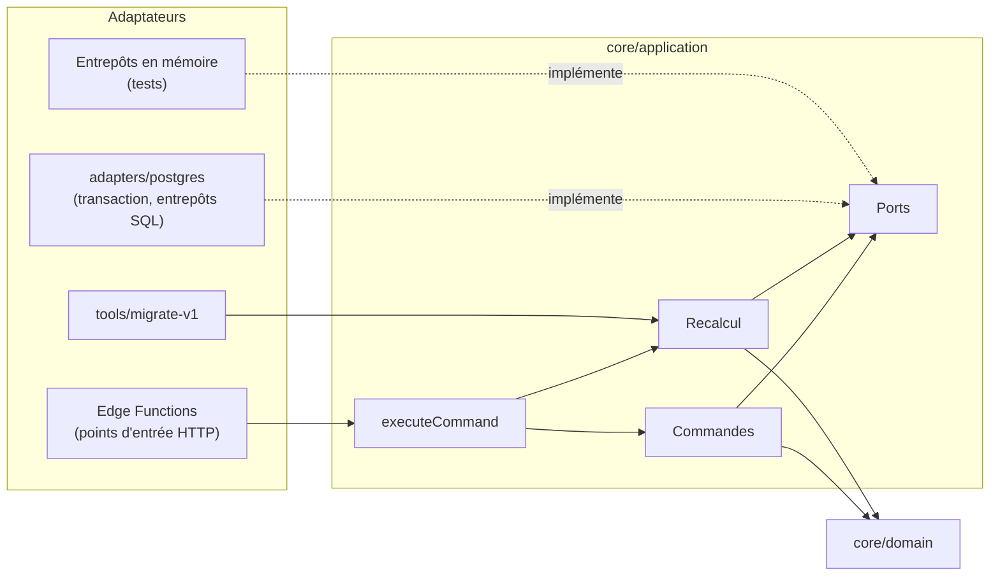

# 0023 — Les écritures en trois couches

- **Statut** : Accepté (2026-11-21)
- **Date** : 2026-11-19
- **Amende** : [0005](0005-ecritures-par-commandes.md) (où vit la logique d'une commande), [0001](0001-monorepo-et-domaine-pur.md) (les paquets)

## Contexte

L'[ADR 0001](0001-monorepo-et-domaine-pur.md) isole un domaine pur, et
l'[ADR 0005](0005-ecritures-par-commandes.md) fait passer chaque écriture par
une commande. L'ADR 0005 promet déjà des commandes testées « avec des dépôts
en mémoire », mais il met toute la commande dans son Edge Function :
autorisation, validation, transaction, contrôle de version, écriture,
recalcul. Il n'existe donc aucun endroit où brancher ces entrepôts en mémoire.

La tranche 1 montre le problème. Le recalcul des projections
(`recomputeProjections`) et l'écriture des faits (`loadPlan`) vivent dans
l'outil de migration `tools/migrate-v1`, et parlent SQL directement. Or
chaque commande de la tranche 2 a besoin du même recalcul.

Côté lecture, la règle est déjà la bonne : les pages dépendent d'une interface
(`DataSource`), et deux implémentations la remplissent, Supabase et la mémoire
des tests ([ADR 0019](0019-lire-la-base-depuis-le-site.md)).

La tranche 2 compte une quinzaine de commandes, qui copieront toutes la
première. C'est le moment de fixer leur forme.

## Décision

**Trois couches.** Chacune n'importe que les couches plus au centre. Une règle
de lint (`no-restricted-imports`, déjà dans ESLint) l'impose paquet par paquet.

### 1. Domaine (`core/domain`)

Inchangé : des règles pures, sans I/O. L'heure est passée en paramètre.

### 2. Application (`core/application`, qui ne dépend que du domaine)

- **Une commande est une fonction** (`importEdition`, `closeSeason`…). Elle
  reçoit son entrée déjà validée, l'acteur et les entrepôts des faits qu'elle
  modifie. Elle ne reçoit **pas** le stockage des projections : seul le
  recalcul les écrit ([ADR 0003](0003-faits-et-projections.md)).
- **`executeCommand` est le seul chemin d'une commande**, et garantit l'ordre
  des ADR 0003, 0005 et 0009 dans une seule transaction :
  1. ouvrir l'unité de travail de l'organisation (transaction et verrou) ;
  2. vérifier que l'acteur est admin de cette organisation ;
  3. exécuter la commande (contrôle de version, faits) ;
  4. écrire la ligne du journal ;
  5. recalculer les projections ;
  6. valider. Une erreur à n'importe quelle étape annule tout.
- **Les ports** sont des interfaces nommées en langage métier :

  | Port                                           | Ce qu'il fait                                                                                          | Qui s'en sert               |
  | ---------------------------------------------- | ------------------------------------------------------------------------------------------------------ | --------------------------- |
  | `UnitOfWork`                                   | Ouvre une transaction pour une organisation, avec son verrou (ADR 0009), et donne les ports ci-dessous | `executeCommand`, migration |
  | `MembershipRepository`                         | Dit si un utilisateur est admin d'une organisation (`organization_members`, ADR 0008)                  | `executeCommand`            |
  | Un entrepôt par agrégat (`EditionRepository`…) | Lit et écrit les faits d'un agrégat, et rend sa version                                                | les commandes               |
  | `CommandLog`                                   | Ajoute la ligne du journal (ADR 0009)                                                                  | `executeCommand`            |
  | `FactsReader`                                  | Lit tous les faits d'une organisation                                                                  | le recalcul                 |
  | `OrganizationRepository`                       | Lit les règles de note de l'organisation (ADR 0008)                                                    | le recalcul                 |
  | `ProjectionStore`                              | Remplace toutes les projections d'une organisation                                                     | le recalcul seulement       |
  | `Clock`                                        | Donne l'heure : date d'une clôture (ADR 0013), date du journal                                         | les commandes, le journal   |

  Un entrepôt n'est créé que lorsqu'une commande en a besoin. Aujourd'hui,
  seules les éditions ont une colonne `version` : un autre agrégat en reçoit
  une par migration, avec la première commande qui le modifie.

- **L'autorisation est vérifiée ici, et seulement ici.** Les commandes
  écrivent par une connexion directe à Postgres, qui ne passe pas par la RLS :
  ce contrôle est leur seul garde. La RLS reste le garde de la lecture, et
  des deux écritures directes du navigateur que l'ADR 0005 garde hors des
  commandes (inscriptions, personnalisation de la carte).
- Un **conflit de version** est une erreur métier, que l'adaptateur traduit.
- Le **recalcul** (`recomputeProjections`) est une fonction de cette couche,
  avec la conversion des lignes en faits (`toFacts`) : les deux quittent
  `migrate-v1`.
  Ces lignes (`FactRows`) portent les noms des colonnes SQL : c'est la forme
  que partagent les adaptateurs, pas un accès à la base. L'application ne
  fait aucune requête.

### 3. Adaptateurs

- `adapters/postgres` implémente les ports avec postgres.js, déjà utilisé.
  Il tourne sous Node (migration) et sous Deno (`npm:postgres`, comme le spike
  de l'ADR 0005) : à vérifier au premier déploiement d'une fonction.
- Des **entrepôts en mémoire** (`core/application/src/testing`)
  implémentent les mêmes ports. **Une même suite de tests de contrat** tourne
  contre les deux implémentations, pour qu'elles ne divergent pas (version,
  conflit, verrou).
- Une **Edge Function** reste mince : lire le JWT pour en tirer l'utilisateur,
  valider l'entrée (`core/contracts`), appeler `executeCommand`, traduire
  le résultat en HTTP (le conflit devient `409`).
- `tools/migrate-v1` n'est pas une commande : c'est un outil qui ouvre
  l'unité de travail, écrit les faits en masse par une opération propre à
  `adapters/postgres` (organisation, vidage, joueurs en deux passes, paquets
  de 500), puis appelle le même recalcul, dans la même transaction.

### La lecture reste à part

Les vues SQL sont le modèle de lecture. Elles ne contiennent aucune règle de
note : seulement des assemblages et de petits agrégats d'affichage (nombres
de matchs et d'éditions, trois champions les plus joués, équipe actuelle,
joueurs fusionnés écartés). Les pages les lisent par `DataSource` (ADR 0019).
Écrire et lire par deux chemins différents est voulu.

### Les contrats

`core/contracts` (prévu par l'ADR 0001) naît avec la première commande qui
a une entrée à valider. Zod est une dépendance : elle sera redemandée à ce
moment-là.

## Options écartées

- **Garder l'ADR 0005 tel quel**, toute la commande dans l'Edge Function :
  moins de fichiers, mais les entrepôts en mémoire promis n'ont nulle part où se
  brancher, et chaque Edge Function réécrit transaction, verrou, journal et
  recalcul.
- **La Clean Architecture complète** (entités, présentateurs, un paquet par
  type d'adaptateur) : trop de cérémonie pour quelques centaines de matchs.
- **Des commandes en fonctions SQL** : la logique échapperait au domaine et à
  ses tests en TypeScript.

## Conséquences

- Une commande se teste en millisecondes, avec des entrepôts en mémoire. Les
  tests contre la base locale vérifient les adaptateurs, les tests de contrat
  et les droits.
- Le verrou, le journal et le recalcul n'existent qu'une fois, dans
  `executeCommand` : une nouvelle commande ne peut pas les oublier.
- Deux paquets de plus (`application`, `postgres`). Chaque nouvel agrégat
  ajoute un port et deux implémentations : on n'en crée qu'à la demande.
- Avant la première commande, un refactor sort le recalcul et l'écriture des
  faits de `migrate-v1`. Les tests de base existants restent verts ; seuls
  leurs imports changent : c'est la preuve que rien d'autre n'a changé.
- L'ADR 0005 reste valable pour le reste : une commande par action métier,
  une transaction, et les deux seules écritures directes du navigateur.
